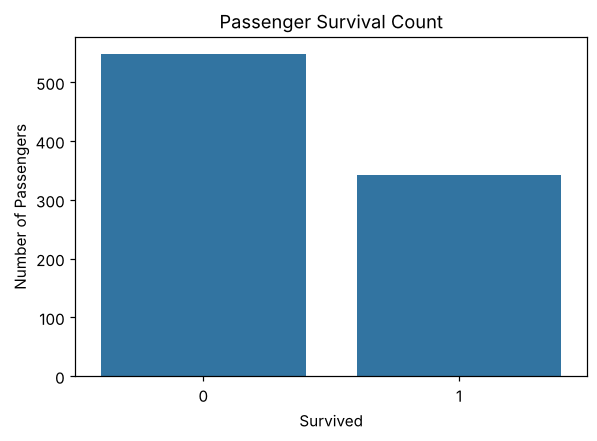
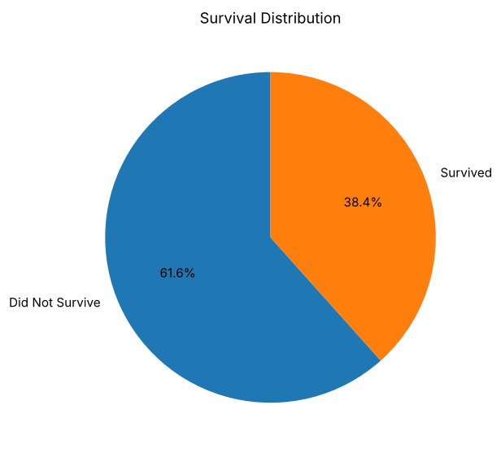
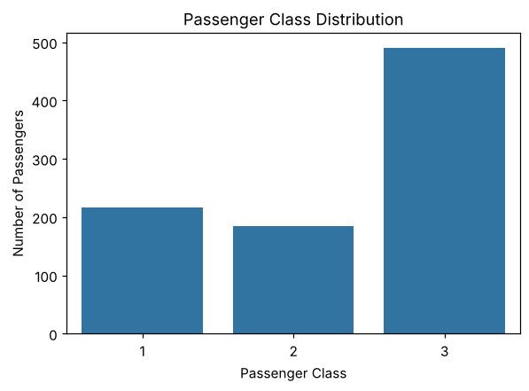
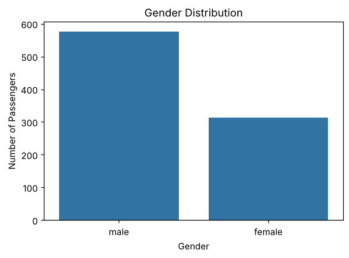
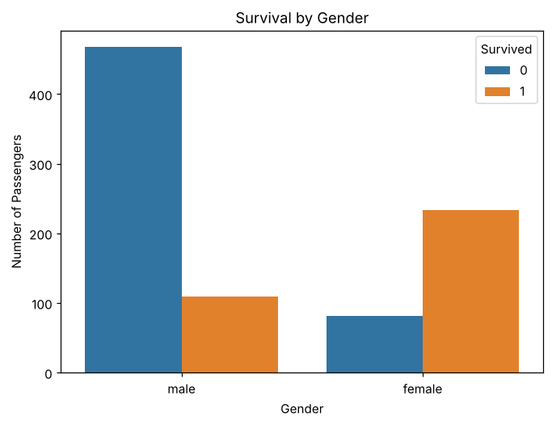
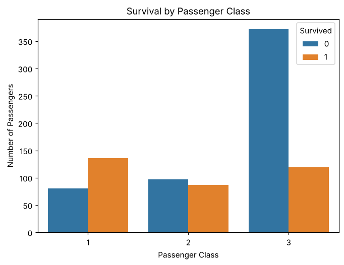
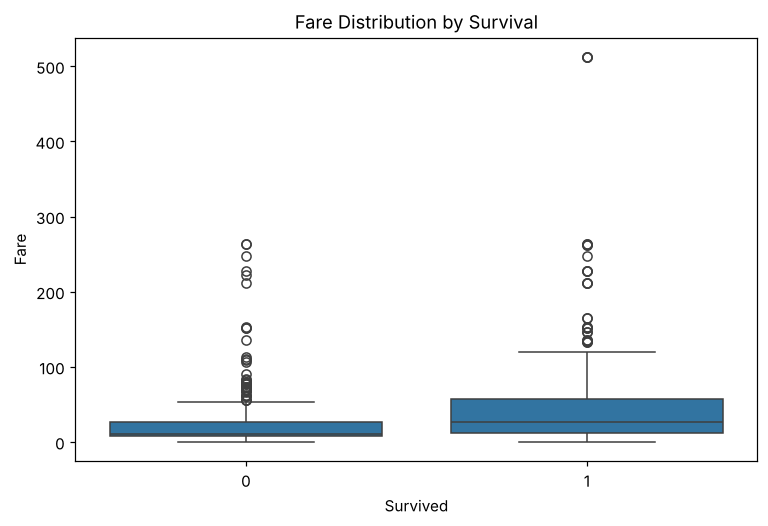
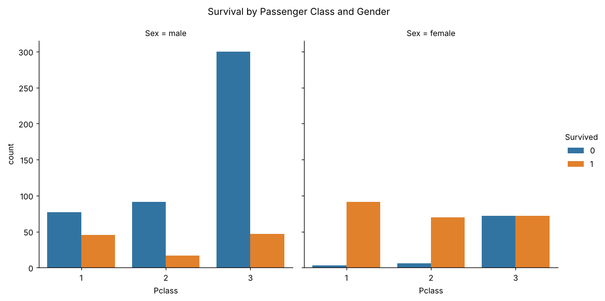
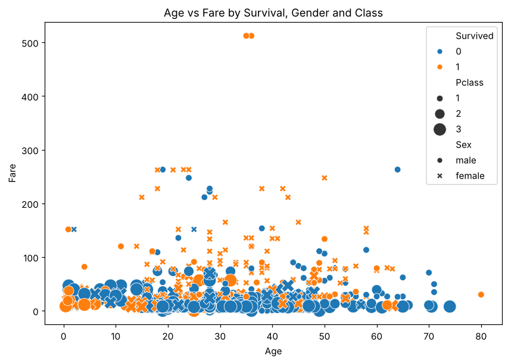
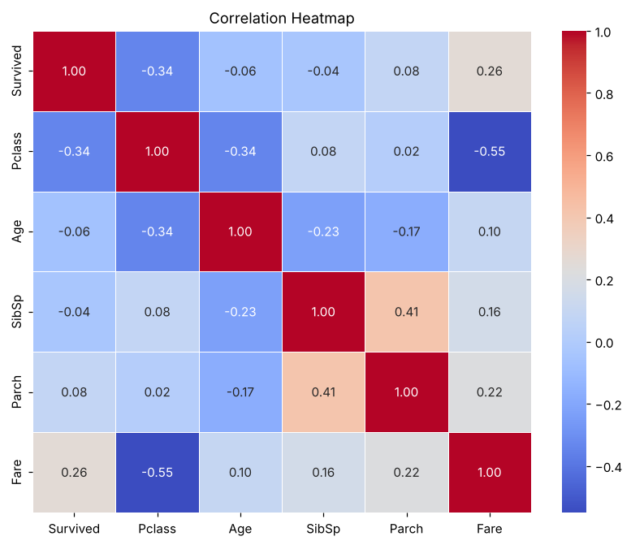

# Exercise 01 — Exploratory Data Analysis

## 1. Aim

To perform Exploratory Data Analysis (EDA) on the Titanic dataset by examining its structure, missing values and statistical summaries, treating the missing data, and visualizing the distributions and relationships between passenger attributes and survival.

## 2. Algorithm

1\. Load the Titanic dataset and display its first, last and randomly sampled records.

2\. Inspect the shape, data types, descriptive statistics and the number and percentage of missing values; visualize the missing values with a heatmap.

3\. Fill the missing Age values with the median, the missing Embarked values with the mode and the missing Cabin values with “Unknown”.

4\. Check for duplicate records and remove them.

5\. Plot the survival, passenger-class and gender distributions using count plots and a pie chart.

6\. Analyze survival against gender, passenger class, fare, and age using count plots, a box plot, a category plot and a scatter plot.

7\. Compute the correlation matrix of the numeric columns and display it as a heatmap.

## 3. Program

```python
import pandas as pd
import numpy as np
import matplotlib.pyplot as plt
import seaborn as sns

data = 'Dataset/titanic.csv'

df = pd.read_csv(data)

df.head()

df.tail()

df.sample(5)

print("Rows and Columns:", df.shape)

df.info()

df.describe()

df.size

df.columns

df.isnull().sum()

missing_percentage = (df.isnull().sum() / len(df)) * 100

print(missing_percentage.sort_values(ascending=False))

plt.figure(figsize=(10, 6))

sns.heatmap(
    df.isnull(),
    cbar=False,
    yticklabels=False,
    cmap="viridis"
)

plt.title("Missing Values Heatmap")
plt.show()

df["Age"] = df["Age"].fillna(df["Age"].median())

df["Embarked"] = df["Embarked"].fillna(df["Embarked"].mode()[0])

df["Cabin"] = df["Cabin"].fillna("Unknown")

print(df.isnull().sum())

print("Number of duplicate rows:", df.duplicated().sum())

df = df.drop_duplicates()

print("Shape after removing duplicates:", df.shape)

plt.figure(figsize=(6, 4))

sns.countplot(data=df, x="Survived")

plt.title("Passenger Survival Count")
plt.xlabel("Survived")
plt.ylabel("Number of Passengers")

plt.show()

survival_counts = df["Survived"].value_counts()

plt.figure(figsize=(6, 6))

plt.pie(
    survival_counts,
    labels=["Did Not Survive", "Survived"],
    autopct="%1.1f%%",
    startangle=90
)

plt.title("Survival Distribution")

plt.show()

plt.figure(figsize=(6, 4))

sns.countplot(data=df, x="Pclass")

plt.title("Passenger Class Distribution")
plt.xlabel("Passenger Class")
plt.ylabel("Number of Passengers")

plt.show()

plt.figure(figsize=(6, 4))

sns.countplot(data=df, x="Sex")

plt.title("Gender Distribution")
plt.xlabel("Gender")
plt.ylabel("Number of Passengers")

plt.show()

plt.figure(figsize=(7, 5))

sns.countplot(
    data=df,
    x="Sex",
    hue="Survived"
)

plt.title("Survival by Gender")
plt.xlabel("Gender")
plt.ylabel("Number of Passengers")

plt.show()

plt.figure(figsize=(7, 5))

sns.countplot(
    data=df,
    x="Pclass",
    hue="Survived"
)

plt.title("Survival by Passenger Class")
plt.xlabel("Passenger Class")
plt.ylabel("Number of Passengers")

plt.show()

plt.figure(figsize=(8, 5))

sns.boxplot(
    data=df,
    x="Survived",
    y="Fare"
)

plt.title("Fare Distribution by Survival")
plt.xlabel("Survived")
plt.ylabel("Fare")

plt.show()

g = sns.catplot(
    data=df,
    x="Pclass",
    hue="Survived",
    col="Sex",
    kind="count",
    height=5,
    aspect=1
)

g.fig.suptitle(
    "Survival by Passenger Class and Gender",
    y=1.05
)

plt.show()

plt.figure(figsize=(9, 6))

sns.scatterplot(
    data=df,
    x="Age",
    y="Fare",
    hue="Survived",
    style="Sex",
    size="Pclass",
    sizes=(50, 200)
)

plt.title("Age vs Fare by Survival, Gender and Class")
plt.xlabel("Age")
plt.ylabel("Fare")

plt.show()

numeric_columns = [
    "Survived",
    "Pclass",
    "Age",
    "SibSp",
    "Parch",
    "Fare"
]

correlation = df[numeric_columns].corr()

print(correlation)

plt.figure(figsize=(9, 7))

sns.heatmap(
    correlation,
    annot=True,
    cmap="coolwarm",
    fmt=".2f",
    linewidths=0.5
)

plt.title("Correlation Heatmap")

plt.show()
```

## 4. Output

The program was executed on the Titanic dataset (titanic.csv) and produced the following output:

```text
   PassengerId  Survived  Pclass  ...     Fare Cabin  Embarked
0            1         0       3  ...   7.2500   NaN         S
1            2         1       1  ...  71.2833   C85         C
2            3         1       3  ...   7.9250   NaN         S
3            4         1       1  ...  53.1000  C123         S
4            5         0       3  ...   8.0500   NaN         S

[5 rows x 12 columns]
     PassengerId  Survived  Pclass  ...   Fare Cabin  Embarked
886          887         0       2  ...  13.00   NaN         S
887          888         1       1  ...  30.00   B42         S
888          889         0       3  ...  23.45   NaN         S
889          890         1       1  ...  30.00  C148         C
890          891         0       3  ...   7.75   NaN         Q

[5 rows x 12 columns]
     PassengerId  Survived  Pclass  ...      Fare        Cabin  Embarked
474          475         0       3  ...    9.8375          NaN         S
248          249         1       1  ...   52.5542          D35         S
226          227         1       2  ...   10.5000          NaN         S
127          128         1       3  ...    7.1417          NaN         S
438          439         0       1  ...  263.0000  C23 C25 C27         S

[5 rows x 12 columns]
Rows and Columns: (891, 12)
<class 'pandas.core.frame.DataFrame'>
RangeIndex: 891 entries, 0 to 890
Data columns (total 12 columns):
 #   Column       Non-Null Count  Dtype
---  ------       --------------  -----
 0   PassengerId  891 non-null    int64
 1   Survived     891 non-null    int64
 2   Pclass       891 non-null    int64
 3   Name         891 non-null    object
 4   Sex          891 non-null    object
 5   Age          714 non-null    float64
 6   SibSp        891 non-null    int64
 7   Parch        891 non-null    int64
 8   Ticket       891 non-null    object
 9   Fare         891 non-null    float64
 10  Cabin        204 non-null    object
 11  Embarked     889 non-null    object
dtypes: float64(2), int64(5), str(5)
memory usage: 83.7 KB
       PassengerId    Survived      Pclass  ...       SibSp       Parch        Fare
count   891.000000  891.000000  891.000000  ...  891.000000  891.000000  891.000000
mean    446.000000    0.383838    2.308642  ...    0.523008    0.381594   32.204208
std     257.353842    0.486592    0.836071  ...    1.102743    0.806057   49.693429
min       1.000000    0.000000    1.000000  ...    0.000000    0.000000    0.000000
25%     223.500000    0.000000    2.000000  ...    0.000000    0.000000    7.910400
50%     446.000000    0.000000    3.000000  ...    0.000000    0.000000   14.454200
75%     668.500000    1.000000    3.000000  ...    1.000000    0.000000   31.000000
max     891.000000    1.000000    3.000000  ...    8.000000    6.000000  512.329200

[8 rows x 7 columns]
10692
Index(['PassengerId', 'Survived', 'Pclass', 'Name', 'Sex', 'Age', 'SibSp',
       'Parch', 'Ticket', 'Fare', 'Cabin', 'Embarked'],
      dtype='object')
PassengerId      0
Survived         0
Pclass           0
Name             0
Sex              0
Age            177
SibSp            0
Parch            0
Ticket           0
Fare             0
Cabin          687
Embarked         2
dtype: int64
Cabin          77.104377
Age            19.865320
Embarked        0.224467
PassengerId     0.000000
Name            0.000000
Pclass          0.000000
Survived        0.000000
Sex             0.000000
Parch           0.000000
SibSp           0.000000
Fare            0.000000
Ticket          0.000000
dtype: float64

PassengerId    0
Survived       0
Pclass         0
Name           0
Sex            0
Age            0
SibSp          0
Parch          0
Ticket         0
Fare           0
Cabin          0
Embarked       0
dtype: int64
Number of duplicate rows: 0
Shape after removing duplicates: (891, 12)
```



















```text
          Survived    Pclass       Age     SibSp     Parch      Fare
Survived  1.000000 -0.338481 -0.064910 -0.035322  0.081629  0.257307
Pclass   -0.338481  1.000000 -0.339898  0.083081  0.018443 -0.549500
Age      -0.064910 -0.339898  1.000000 -0.233296 -0.172482  0.096688
SibSp    -0.035322  0.083081 -0.233296  1.000000  0.414838  0.159651
Parch     0.081629  0.018443 -0.172482  0.414838  1.000000  0.216225
Fare      0.257307 -0.549500  0.096688  0.159651  0.216225  1.000000
```



## 5. Result

Thus, the Exploratory Data Analysis on the Titanic dataset was implemented successfully. The dataset contains 891 records and 12 columns. Cabin (77.10%), Age (19.87%) and Embarked (0.22%) had missing values, which were treated, and no duplicate rows were found. Only 38.4% of the passengers survived, and the correlation analysis showed that survival is negatively correlated with passenger class (−0.34) and positively correlated with fare (0.26).
