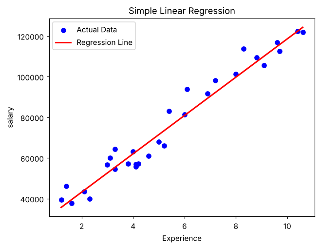

# Exercise 02 — Simple Linear Regression

## 1. Aim

To implement Simple Linear Regression to predict an employee’s salary from the years of experience and to evaluate the fitted regression line.

## 2. Algorithm

1\. Load the salary dataset and select YearsExperience as the independent variable and Salary as the dependent variable.

2\. Check the size, shape and missing values of the dataset.

3\. Split the data into training and testing sets in an 80:20 ratio with random_state = 42.

4\. Train a Linear Regression model on the training data.

5\. Predict the salaries of the test set and compare them with the actual values.

6\. Display the slope, intercept, Mean Squared Error and R² score.

7\. Predict the salary for 2.1 years of experience.

8\. Plot the actual data points together with the regression line.

## 3. Program

```python
import pandas as pd
import numpy as np
import matplotlib.pyplot as plt
import seaborn as sns
from sklearn.model_selection import train_test_split
from sklearn.linear_model import LinearRegression
from sklearn.metrics import mean_squared_error, r2_score

data = "Dataset/Salary.csv"
df = pd.read_csv(data)
df = df[['YearsExperience','Salary']]

df

df.size

df.shape

df.isnull().sum()

X = df[['YearsExperience']]   # Independent Variable
y = df['Salary']     # Dependent Variable

X_train, X_test, y_train, y_test = train_test_split(X, y, random_state=42, test_size=0.2)

model = LinearRegression()

model.fit(X_train, y_train)

y_pred = model.predict(X_test)

print("Actual Values:")
print(y_test.values)

print("Predicted Values:")
print(y_pred)

print("Coefficient (Slope):", model.coef_[0])
print("Intercept:", model.intercept_)
print("Mean Squared Error:", mean_squared_error(y_test, y_pred))
print("R2 Score:", r2_score(y_test, y_pred))

YearsExperience = [[2.1]]
predicted_salary = model.predict(YearsExperience)

print("Predicted salary for 2.1 years:", predicted_salary[0])

plt.scatter(X, y, color='blue', label='Actual Data')
plt.plot(X, model.predict(X), color='red', linewidth=2, label='Regression Line')

plt.xlabel("Experience")
plt.ylabel("salary")
plt.title("Simple Linear Regression")
plt.legend()
plt.show()
```

## 4. Output

The program was executed on the Salary dataset (Salary.csv) and produced the following output:

```text
    YearsExperience    Salary
0               1.2   39344.0
1               1.4   46206.0
2               1.6   37732.0
3               2.1   43526.0
4               2.3   39892.0
5               3.0   56643.0
6               3.1   60151.0
7               3.3   54446.0
8               3.3   64446.0
9               3.8   57190.0
10              4.0   63219.0
11              4.1   55795.0
12              4.1   56958.0
13              4.2   57082.0
14              4.6   61112.0
15              5.0   67939.0
16              5.2   66030.0
17              5.4   83089.0
18              6.0   81364.0
19              6.1   93941.0
20              6.9   91739.0
21              7.2   98274.0
22              8.0  101303.0
23              8.3  113813.0
24              8.8  109432.0
25              9.1  105583.0
26              9.6  116970.0
27              9.7  112636.0
28             10.4  122392.0
29             10.6  121873.0
60
(30, 2)
YearsExperience    0
Salary             0
dtype: int64
Actual Values:
[112636.  67939. 113813.  83089.  64446.  57190.]
Predicted Values:
[115791.21011287  71499.27809463 102597.86866063  75268.80422384
  55478.79204548  60190.69970699]
Coefficient (Slope): 9423.815323030976
Intercept: 24380.201479473704
Mean Squared Error: 49830096.855908394
R2 Score: 0.9024461774180497
Predicted salary for 2.1 years: 44170.21365783876
```



## 5. Result

Thus, the Simple Linear Regression practical was implemented successfully. The fitted line has a slope of 9423.82 and an intercept of 24380.20, giving an R² score of 0.9024 and a Mean Squared Error of 49830096.86 on the test set. The predicted salary for 2.1 years of experience is 44170.21.
