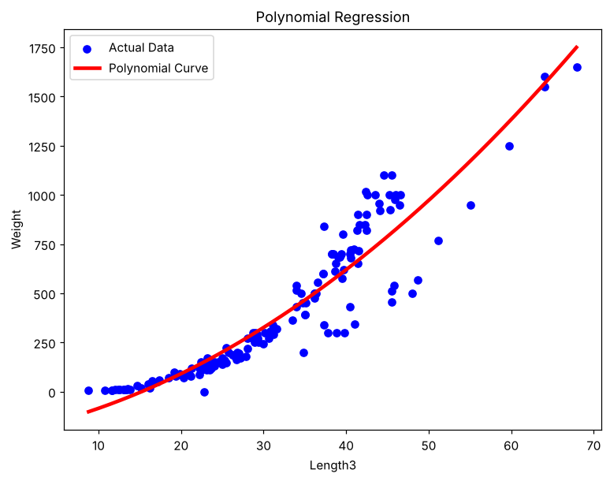

# Exercise 04 — Polynomial Regression

## 1. Aim

To implement degree-2 Polynomial Regression to predict the weight of a fish from its measurements, evaluate the predictions with regression metrics, and visualize the fitted curve.

## 2. Algorithm

1\. Load and inspect the fish dataset.

2\. Encode the Species column using one-hot encoding.

3\. Separate Weight as the target variable and the remaining columns as predictors.

4\. Split the data into training and testing sets in an 80:20 ratio with random_state = 42.

5\. Generate degree-2 polynomial features using PolynomialFeatures.

6\. Train a Linear Regression model on the transformed features and predict the test set.

7\. Calculate MAE, MSE, RMSE, R², MAPE, Explained Variance and Maximum Error.

8\. Plot the polynomial relationship between Length3 and Weight.

## 3. Program

```python
import pandas as pd
import numpy as np
import matplotlib.pyplot as plt
from sklearn.model_selection import train_test_split
from sklearn.preprocessing import PolynomialFeatures
from sklearn.linear_model import LinearRegression

from sklearn.metrics import (
    mean_absolute_error,
    mean_squared_error,
    r2_score,
    mean_absolute_percentage_error,
    explained_variance_score,
    max_error
)

data = 'Dataset/fish.csv'
df = pd.read_csv(data)

df.head()

df.info()

df.shape

df = pd.get_dummies(df, columns=['Species'], drop_first=True)

X = df.drop("Weight", axis=1)
y = df["Weight"]

x1, x2, y_train, y_test = train_test_split(
    X,
    y,
    test_size=0.2,
    random_state=42
)

poly = PolynomialFeatures(degree=2)

X_train_poly = poly.fit_transform(x1)
X_test_poly = poly.transform(x2)

model = LinearRegression()

model.fit(X_train_poly, y_train)

# Prediction
y_pred = model.predict(X_test_poly)

mae = mean_absolute_error(y_test, y_pred)
mse = mean_squared_error(y_test, y_pred)
rmse = np.sqrt(mse)
r2 = r2_score(y_test, y_pred)
mape = mean_absolute_percentage_error(y_test, y_pred)
evs = explained_variance_score(y_test, y_pred)
maxerr = max_error(y_test, y_pred)

# Adjusted R²
n = X_test_poly.shape[0]
p = X_test_poly.shape[1] - 1

adj_r2 = 1 - ((1-r2)*(n-1)/(n-p-1))

print("\n========== Evaluation Metrics ==========")

print("MAE :", mae)
print("MSE :", mse)
print("RMSE :", rmse)
print("R2 Score :", r2)
print("Adjusted R2 :", adj_r2)
print("MAPE :", mape)
print("Explained Variance :", evs)
print("Maximum Error :", maxerr)

X = df[['Length3']]
y = df['Weight']
poly = PolynomialFeatures(degree=2)

X_poly = poly.fit_transform(X)

model = LinearRegression()
model.fit(X_poly, y)

X_grid = np.arange(
    X.min().values[0],
    X.max().values[0],
    0.1
).reshape(-1,1)

plt.figure(figsize=(8,6))

plt.scatter(X, y, color="blue", label="Actual Data")

plt.plot(
    X_grid,
    model.predict(poly.transform(X_grid)),
    color="red",
    linewidth=3,
    label="Polynomial Curve"
)

plt.xlabel("Length3")
plt.ylabel("Weight")
plt.title("Polynomial Regression")
plt.legend()
plt.show()
```

## 4. Output

The program was executed on the Fish dataset (fish.csv) and produced the following output:

```text
  Species  Weight  Length1  Length2  Length3   Height   Width
0   Bream   242.0     23.2     25.4     30.0  11.5200  4.0200
1   Bream   290.0     24.0     26.3     31.2  12.4800  4.3056
2   Bream   340.0     23.9     26.5     31.1  12.3778  4.6961
3   Bream   363.0     26.3     29.0     33.5  12.7300  4.4555
4   Bream   430.0     26.5     29.0     34.0  12.4440  5.1340
<class 'pandas.core.frame.DataFrame'>
RangeIndex: 159 entries, 0 to 158
Data columns (total 7 columns):
 #   Column   Non-Null Count  Dtype
---  ------   --------------  -----
 0   Species  159 non-null    object
 1   Weight   159 non-null    float64
 2   Length1  159 non-null    float64
 3   Length2  159 non-null    float64
 4   Length3  159 non-null    float64
 5   Height   159 non-null    float64
 6   Width    159 non-null    float64
dtypes: float64(6), str(1)
memory usage: 8.8 KB
(159, 7)

========== Evaluation Metrics ==========
MAE : 48.409823644028464
MSE : 5620.7129176326325
RMSE : 74.97141400315611
R2 Score : 0.9604841036350548
Adjusted R2 : 1.0266302779850718
MAPE : 0.24553055496984066
Explained Variance : 0.9618750799874711
Maximum Error : 266.19008812732295
```



## 5. Result

Thus, the Polynomial Regression practical was implemented successfully. The degree-2 model achieved an R² score of 0.9605, an MAE of 48.41 and an RMSE of 74.97 on the test set, showing that the curved relationship between the fish measurements and weight is captured well.
