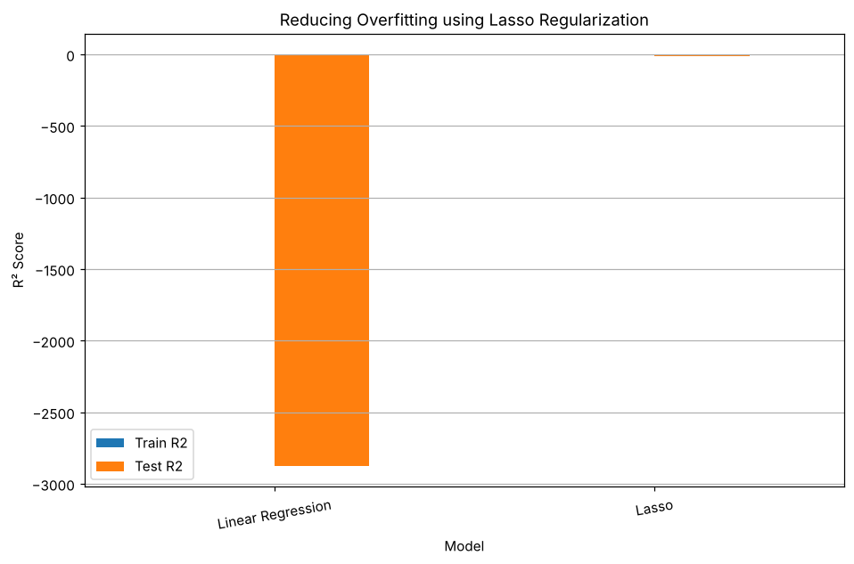

# Exercise 06 — Lasso Regression

## 1. Aim

To implement Lasso Regression (L1 regularization) on the housing dataset using fourth-degree polynomial features and to show how it reduces the overfitting of an ordinary linear regression model.

## 2. Algorithm

1\. Load the housing dataset and convert the categorical columns into dummy variables.

2\. Separate the predictors from the target variable price and split the data in an 80:20 ratio with random_state = 42.

3\. Standardize the features using StandardScaler.

4\. Expand the 13 scaled features into 2379 polynomial features of degree 4.

5\. Train an ordinary Linear Regression model and record its training and testing R² scores.

6\. Train a Lasso Regression model with alpha = 0.1 and max_iter = 50000 and record its training and testing R² scores.

7\. Compare the two models in a table and a bar chart, and calculate the gap between training and testing R².

## 3. Program

```python
import pandas as pd
import numpy as np
import matplotlib.pyplot as plt

from sklearn.model_selection import train_test_split
from sklearn.preprocessing import StandardScaler, PolynomialFeatures
from sklearn.linear_model import LinearRegression, Lasso
from sklearn.metrics import r2_score

df = pd.read_csv("Housing.csv")

df.head()

df = pd.get_dummies(df, drop_first=True)

df.head()

X = df.drop("price", axis=1)
y = df["price"]

X_train,X_test,y_train,y_test = train_test_split(
X,
y,
test_size=0.2,
random_state=42
)

scaler = StandardScaler()

X_train_scaled = scaler.fit_transform(X_train)
X_test_scaled = scaler.transform(X_test)

poly = PolynomialFeatures(
    degree=4,
    include_bias=False
)

X_train_poly = poly.fit_transform(X_train_scaled)
X_test_poly = poly.transform(X_test_scaled)

print("Original Features :", X_train.shape[1])
print("Polynomial Features :", X_train_poly.shape[1])

linear = LinearRegression()

linear.fit(X_train_poly, y_train)

train_pred = linear.predict(X_train_poly)
test_pred = linear.predict(X_test_poly)

train_r2 = r2_score(y_train, train_pred)
test_r2 = r2_score(y_test, test_pred)

print("LINEAR REGRESSION")
print("Training R2 :", round(train_r2,4))
print("Testing R2 :", round(test_r2,4))

lasso = Lasso(
    alpha=0.1,
    max_iter=50000
)

lasso.fit(X_train_poly, y_train)

train_pred = lasso.predict(X_train_poly)
test_pred = lasso.predict(X_test_poly)

lasso_train = r2_score(y_train, train_pred)
lasso_test = r2_score(y_test, test_pred)

print("LASSO")
print("Training R2 :", round(lasso_train,4))
print("Testing R2 :", round(lasso_test,4))

comparison = pd.DataFrame({

    "Model":[
        "Linear Regression",
        "Lasso"
    ],

    "Train R2":[
        train_r2,
        lasso_train
    ],

    "Test R2":[
        test_r2,
        lasso_test
    ]
})

print(comparison)

comparison.plot(
    x="Model",
    y=["Train R2", "Test R2"],
    kind="bar",
    figsize=(10,6)
)

plt.title("Reducing Overfitting using Lasso Regularization")
plt.ylabel("R² Score")
plt.xticks(rotation=10)
plt.grid(axis="y")
plt.show()

comparison["Difference"] = comparison["Train R2"] - comparison["Test R2"]

print(comparison)
```

## 4. Output

The program was executed on the Housing dataset (Housing.csv) and produced the following output:

```text
      price  area  bedrooms  ...  parking  prefarea furnishingstatus
0  13300000  7420         4  ...        2       yes        furnished
1  12250000  8960         4  ...        3        no        furnished
2  12250000  9960         3  ...        2       yes   semi-furnished
3  12215000  7500         4  ...        3       yes        furnished
4  11410000  7420         4  ...        2        no        furnished

[5 rows x 13 columns]
      price  ...  furnishingstatus_unfurnished
0  13300000  ...                         False
1  12250000  ...                         False
2  12250000  ...                         False
3  12215000  ...                         False
4  11410000  ...                         False

[5 rows x 14 columns]
Original Features : 13
Polynomial Features : 2379
LINEAR REGRESSION
Training R2 : 0.994
Testing R2 : -2874.767
LASSO
Training R2 : 0.9922
Testing R2 : -13.4971
               Model  Train R2      Test R2
0  Linear Regression  0.994023 -2874.766987
1              Lasso  0.992212   -13.497146
```



```text
               Model  Train R2      Test R2   Difference
0  Linear Regression  0.994023 -2874.766987  2875.761010
1              Lasso  0.992212   -13.497146    14.489358
```

## 5. Result

Thus, the Lasso Regression practical was implemented successfully. Compared with the ordinary linear model (training R² 0.9940, testing R² −2874.77), Lasso Regression (alpha = 0.1) obtained a training R² of 0.9922 and a testing R² of −13.50, reducing the gap between training and testing scores from 2875.76 to 14.49. Lasso lowered the overfitting considerably, although a stronger penalty would be needed for a positive testing R².
