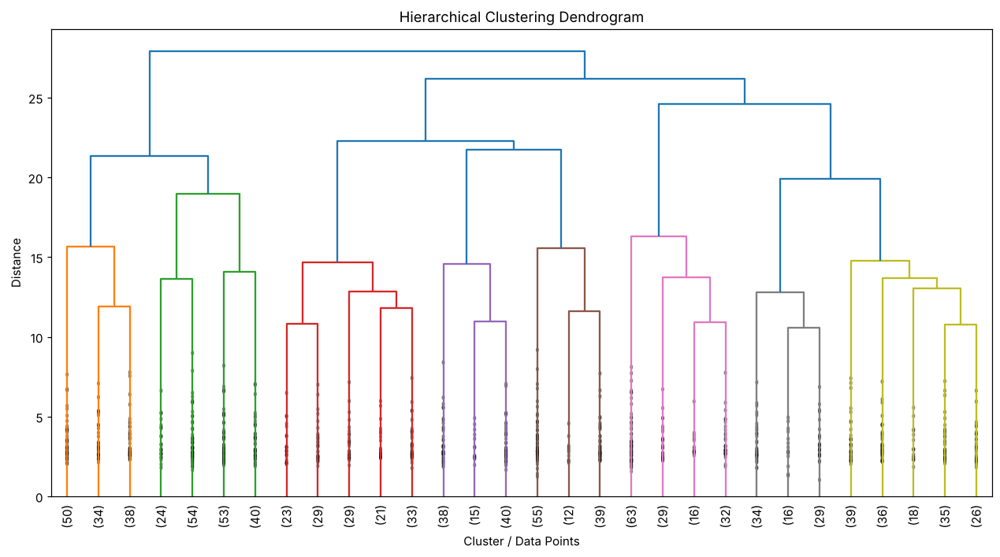

# Exercise 14 — Hierarchical Clustering

## 1. Aim

To perform hierarchical clustering on the preprocessed heart disease dataset using Ward linkage and to visualize the hierarchy with a dendrogram.

## 2. Algorithm

1\. Load the dataset and remove the target column Heart Disease.

2\. Identify the numerical and categorical features.

3\. Standardize the numerical features and one-hot encode the categorical features.

4\. Convert the processed data into a dense array of 1000 records and 27 features.

5\. Perform agglomerative clustering using the Ward linkage method.

6\. Plot the truncated dendrogram showing the last 30 merged clusters.

## 3. Program

```python
import pandas as pd
import matplotlib.pyplot as plt

from sklearn.compose import ColumnTransformer
from sklearn.preprocessing import StandardScaler, OneHotEncoder

from scipy.cluster.hierarchy import (
    dendrogram,
    linkage
)

df = pd.read_csv("heart_disease_dataset.csv")

print("Dataset Shape:", df.shape)
print("\nFirst 5 records:")
print(df.head())

X = df.drop("Heart Disease", axis=1)

numeric_features = X.select_dtypes(
    include=["int64", "float64"]
).columns

categorical_features = X.select_dtypes(
    include=["object"]
).columns

preprocessor = ColumnTransformer(
    transformers=[
        ("num", StandardScaler(), numeric_features),
        ("cat", OneHotEncoder(handle_unknown="ignore"), categorical_features)
    ]
)

X_processed = preprocessor.fit_transform(X)

# Check whether X_processed is sparse or already a NumPy array
if hasattr(X_processed, "toarray"):
    X_processed = X_processed.toarray()

print("\nProcessed Data Shape:")
print(X_processed.shape)

linked = linkage(
    X_processed,
    method="ward"
)

plt.figure(figsize=(14, 7))

dendrogram(
    linked,
    truncate_mode="lastp",
    p=30,
    leaf_rotation=90,
    leaf_font_size=10,
    show_contracted=True
)

plt.title("Hierarchical Clustering Dendrogram")
plt.xlabel("Cluster / Data Points")
plt.ylabel("Distance")

plt.show()
```

## 4. Output

The program was executed on the Heart disease dataset (heart_disease_dataset.csv) and produced the following output:

```text
Dataset Shape: (1000, 16)

First 5 records:
   Age  Gender  ...   Chest Pain Type  Heart Disease
0   75  Female  ...   Atypical Angina              1
1   48    Male  ...    Typical Angina              0
2   53    Male  ...   Atypical Angina              1
3   69  Female  ...  Non-anginal Pain              0
4   62  Female  ...      Asymptomatic              0

[5 rows x 16 columns]

Processed Data Shape:
(1000, 27)
```



## 5. Result

Thus, the Hierarchical Clustering practical was implemented successfully. Ward linkage was applied to the 1000 records with 27 processed features, and the resulting dendrogram shows how the records are merged step by step into larger clusters.
